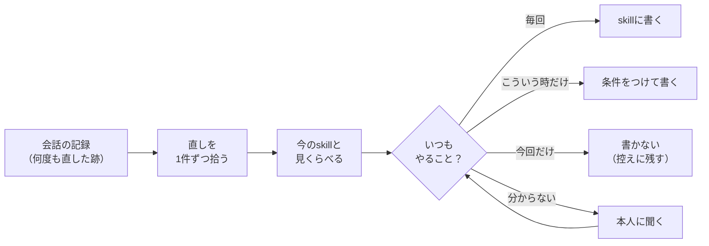
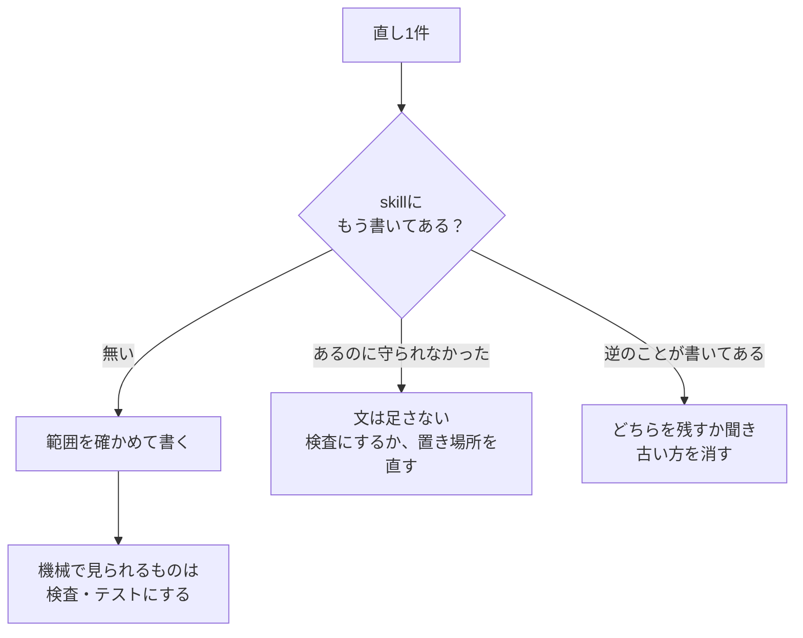

# skill-eval

AIに作らせたブログ・X投稿・動画を、何度も直して仕上げた。
その**直しを、次から言わなくて済むようにする** Claude Code 用の skill です。

会話の記録から直しを拾い、今ある skill に決まりとして書き足します。

## しくみ



## なぜ聞くのか

直しをそのまま全部書くと、**今回だけの直しが、毎回の決まりになってしまいます**。

| 直しの言葉 | 本当の範囲 | そのまま書くと |
|---|---|---|
| 「7:24あたりで別動画にすると言って」 | 今回だけ | 全部の動画で同じことを言う |
| 「2年返却か一括かを札で書いて」 | 2つが混ざる図だけ | 要らない図にも札が付く |
| 「まとめは必ず入れて」 | 毎回 | 問題なし |

そこで、範囲がはっきりしない直しは、選ぶだけの質問で確かめます。

```text
「2年返却か一括かを札で書いて」は、いつやりますか？

  ○ 毎回
  ● 2年返却と一括が同じ図に混ざる時だけ
  ○ 今回だけ（登録しない）
```

AIが作業中に自分の判断で書いた決まりも、本人の言葉より広くなっていないか見直します。

## 書き足し方



## 入れ方

```bash
npx skills add tamacolet/skill-eval
```

または:

```bash
git clone https://github.com/tamacolet/skill-eval.git ~/.claude/skills/skill-eval
```

要るものは Node.js 20 以上だけです。

## 使い方

何度か直して仕上げたあと、Claude Code にこう頼みます。

- 「今回の直しを skill に反映して」
- 「同じ訂正を繰り返さなくていいようにして」
- 「skill に入れた決まりが広すぎないか見て」

会話の記録から発言だけを取り出す道具としても使えます。

```bash
E=~/.claude/skills/skill-eval/scripts/extract-log.mjs
node $E find --grep "<探す言葉>" --days 3        # 会話を探す
node $E extract <会話IDの先頭8字> --out log.md    # 人の発言を取り出す
```

## 中身

| ファイル | 役目 |
|---|---|
| `SKILL.md` | 流れ・質問の形・守ること |
| `references/judge.md` | 直しの拾い方・範囲の決め方・書き方・確かめ方 |
| `references/skipped.md` | 「今回だけ」と決めた直しの控え |
| `scripts/extract-log.mjs` | 会話の記録から発言を取り出す |

## 作者の環境に寄った所

作者が普段使っている版をそのまま置いています。

- 報告ページ（`show-me`）と自動応答（auto-reply）は作者の環境の道具です。無くても、質問に画面で答えれば動きます。
- skill の大きさ検査は Anthropic の `skill-creator` の `quick_validate.py` を使います。

## ライセンス

MIT
