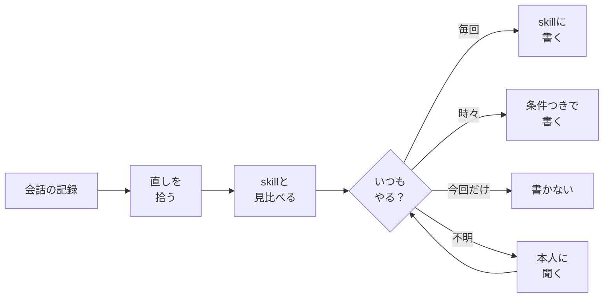
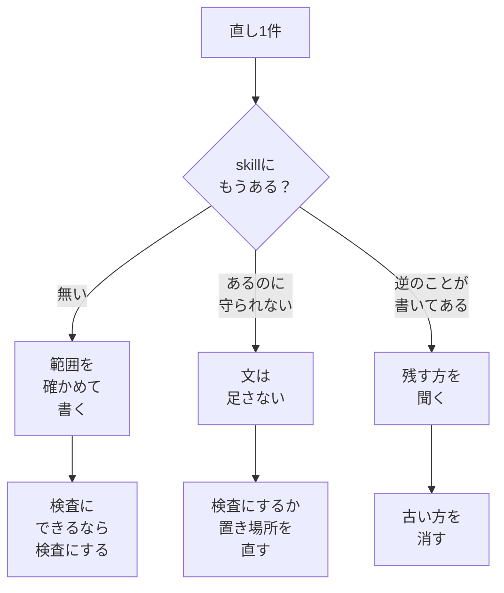

# skill-eval

AIに頼んだ文章・資料・動画・コードを、何度も直して仕上げた。
その**直しを、次から言わなくて済むようにする** Claude Code 用の skill です。

会話の記録から直しを拾い、今ある skill に決まりとして書き足します。
作るものの種類は問いません。

## しくみ



## なぜ聞くのか

直しをそのまま全部書くと、**今回だけの直しが、毎回の決まりになってしまいます**。

| 直しの言葉 | 本当の範囲 | そのまま書くと |
|---|---|---|
| 「3枚目の図だけ色を変えて」 | 今回だけ | 全部の図の色が変わる |
| 「表に単位を書いて」 | 金額の表だけ | 要らない表にも単位が付く |
| 「まとめは必ず入れて」 | 毎回 | 問題なし |

そこで、範囲がはっきりしない直しは、選ぶだけの質問で確かめます。

```text
「表に単位を書いて」は、いつやりますか？

  ○ 毎回
  ● 金額の表だけ
  ○ 今回だけ（登録しない）
```

AIが作業中に自分の判断で書いた決まりも、本人の言葉より広くなっていないか見直します。

## 書き足し方



## 入れ方

```bash
npx skills add tamacolet/skill-eval
```

または:

```bash
git clone https://github.com/tamacolet/skill-eval.git ~/.claude/skills/skill-eval
```

要るものは Claude Code と Node.js 20 以上だけです。ほかの道具や決まった置き場所には頼りません。

## 使い方

何度か直して仕上げたあと、Claude Code にこう頼みます。

- 「今回の直しを skill に反映して」
- 「同じ訂正を繰り返さなくていいようにして」
- 「skill に入れた決まりが広すぎないか見て」

会話の記録から発言だけを取り出す道具としても使えます。

```bash
E=~/.claude/skills/skill-eval/scripts/extract-log.mjs   # 入れた場所に合わせる
node $E find --grep "<探す言葉>" --days 3        # 会話を探す
node $E extract <会話IDの先頭8字> --out log.md    # 人の発言を取り出す
```

## 中身

| ファイル | 役目 |
|---|---|
| `SKILL.md` | 流れ・質問の形・守ること |
| `references/judge.md` | 直しの拾い方・範囲の決め方・書き方・確かめ方 |
| `references/skipped.md` | 「今回だけ」と決めた直しの控え |
| `scripts/extract-log.mjs` | 会話の記録から発言を取り出す |

## 自分の環境に合わせる

自分の環境だけの手順（報告の出し方、検査のコマンドなど）は `references/local.md` に書いておくと、最初に読みます。無くても動きます。

## ライセンス

MIT
